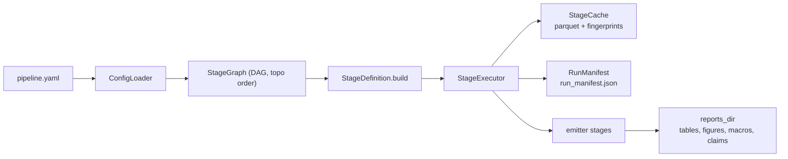

# Architecture

## Package Layout

```
src/reproducible_econ/
├── config.py             # ConfigLoader: YAML loading, includes, ${var} interpolation; get_nested, resolve_project_root
├── pipeline/
│   ├── stage.py          # BaseStage (run(data, config) contract), StageDefinition (YAML spec -> stage instance)
│   ├── graph.py          # StageGraph: DAG construction, cycle/missing-producer checks, topological ordering, target resolution
│   ├── executor.py       # StageExecutor: runs stages, consults StageCache, records RunManifest entries
│   └── runner.py         # PipelineRunner: CLI entry point (python -m reproducible_econ.pipeline.runner) + programmatic API
├── tracking/
│   ├── fingerprint.py    # CacheFingerprint: v2 fingerprints over config/sources/upstream frames/stage code/deps; sha256 helpers
│   ├── metadata.py       # CacheArtifactMetadata: frame/content schema hashes, metadata sidecar build + validation
│   ├── cache.py          # StageCache: atomic parquet cache, emitter stamps, retention pruning, miss-reason classification
│   └── manifest.py       # RunManifest: run-level and per-stage provenance, atomic run_manifest.json
├── emitters/
│   ├── tables.py         # LatexTableStage: booktabs LaTeX tables (+ optional CSV mirror)
│   ├── macros.py         # LatexMacroStage: \newcommand paper macros from tidy DataFrames
│   ├── figures.py        # FigureStageBase: matplotlib base stage with lazy import and graceful skip
│   └── claims.py         # ClaimCheck / ClaimCheckStage: declarative claim verification, claims_report.json
└── examples/
    └── macro_demo.py     # Synthetic Phillips curve stages used by references/configs/example_pipeline.yaml
```

`reproducible_econ/__init__.py` re-exports `BaseStage`, `ConfigLoader`, `StageDefinition`, `StageExecutor`, `StageGraph`, `emitters`, and (lazily) `PipelineRunner`.

## Execution Flow



1. `PipelineRunner` loads the YAML via `ConfigLoader` (includes merged, `${var}` tokens interpolated, output paths anchored to the project root).
2. Stage specs become `StageDefinition` objects; `StageGraph` validates the DAG and orders it.
3. `StageExecutor` runs each stage: cached stages load/save parquet via `StageCache` keyed by `CacheFingerprint`; every stage's status is recorded in `RunManifest`.
4. Non-cached emitter stages write tables, figures, macros, and the claims report under `output.reports_dir`; emitted files are hashed into the manifest.
5. `executor.finalize()` writes `run_manifest.json` (plus optional timestamped copy) under `reports_dir`.

## Overleaf Note

There is no Overleaf sync, git-push, or API code. Point `output.reports_dir` at a subfolder inside a local clone of your Overleaf project and commit/push with your own git workflow. See [projects.md](projects.md) for the recommended setup.
